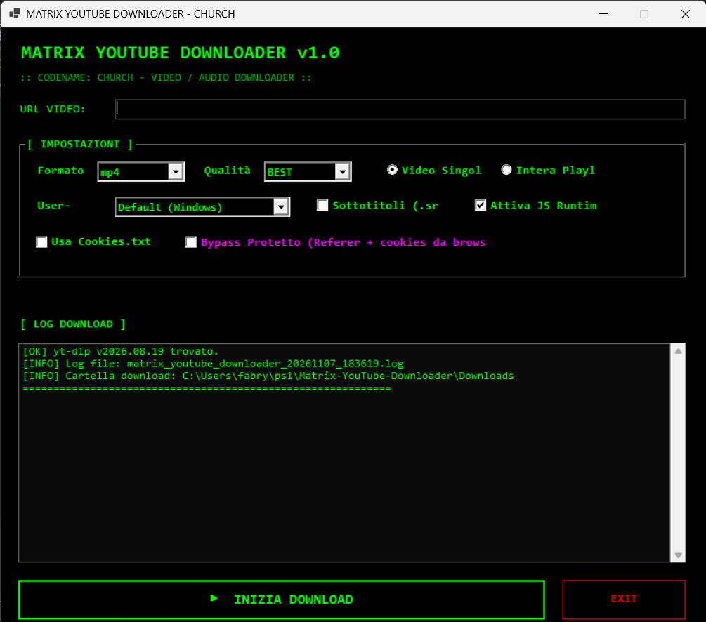

# 🎬 Matrix YouTube Downloader

> **Codename: Church** — *"Il modo più veloce per estrarre un video."*

Downloader video/audio multi-piattaforma con GUI Matrix. 
Basato sul motore `yt-dlp`, supporta l'estrazione audio, la scelta della qualità e il download di intere playlist.

## ✨ Feature

- ✅ **Interfaccia Matrix**: sfondo nero, testo verde, font Consolas.
- ✅ **Motore yt-dlp**: scarica da YouTube e da centinaia di altri siti supportati.
- ✅ **Formati multipli**: MP4, MKV, MP3, FLAC.
- ✅ **Scelta Qualità**: 360p, 720p, 1080p, BEST.
- ✅ **Estrazione Audio**: converte direttamente in MP3 o FLAC.
- ✅ **Gestione Playlist**: opzione per scaricare l'intero elenco.
- ✅ **Sottotitoli**: incorpora i sottotitoli italiani e inglesi (`.srt`).
- ✅ **User-Agent Personalizzato**: maschera il downloader come browser Desktop o Mobile.
- ✅ **Bypass Protetto**: utilizza i cookie del browser per superare i controlli.
- ✅ **Auto-Installazione**: scarica `yt-dlp.exe` automaticamente se non presente.
- ✅ **Progress Bar reale**: mostra la percentuale di download in tempo reale (grazie al flag `--newline`).

## 📋 Requisiti

- **Windows 10 / 11**
- **PowerShell 7.2+** (scarica da https://aka.ms/powershell)
- **FFmpeg** (per unire video e audio e per l'estrazione audio)
  - Installa con: `winget install Gyan.FFmpeg`

## 🚀 Quick start

1. Clona il repo o scarica lo ZIP.
2. Fai doppio click su `avvia.bat`.
3. Se `yt-dlp` non è presente, il tool ti chiederà di scaricarlo automaticamente.
4. Incolla un link nella casella URL, scegli il formato e clicca **INIZIA DOWNLOAD**.

## 🎯 Casi d'uso

- Scaricare video da YouTube per vederli offline.
- Estrarre l'audio di un concerto o di un'intervista.
- Scaricare un'intera playlist di musica.
- Archiviare video che potrebbero essere rimossi dalla piattaforma.
- Scaricare video con l'audio in italiano e i sottotitoli incorporati.

## ⚠️ Attenzione

- Il tool è pensato per **uso personale**. Rispetta i termini di servizio delle piattaforme e le leggi sul copyright.
- La modalità "Bypass Protetto" utilizza i cookie del browser per mascherare il downloader. Usala con consapevolezza.
- Se il download fallisce (es. video protetto da DRM o bloccato in una regione), `yt-dlp` mostrerà l'errore nel log. Il tool non ha un fallback automatico per questi casi (per ora).

## 📝 Changelog

### [1.0.0] - 2026-11-07
#### Aggiunto
- GUI Matrix con supporto per formati video/audio.
- Integrazione con `yt-dlp` e `FFmpeg`.
- Auto-installazione di `yt-dlp` se mancante.
- Progress Bar in tempo reale.
- Gestione playlist e sottotitoli.
- User-Agent e Bypass Protetto.
- Log a schermo e log su file.

## 📜 Licenza

MIT (vedi LICENSE).

## 🙏 Crediti

- Sviluppato con PowerShell 7 + WinForms + yt-dlp + FFmpeg.
- Fabry Toolbox.
